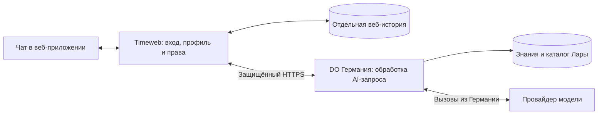

# Подключение Лары к веб-приложению

Исследование от 4 ноября 2026 года, до реализации. Текущее устройство и выпуск описаны в [LARA_WEB_CHAT.md](LARA_WEB_CHAT.md). Реализация и публикация подключения не выполнялись. Выводы основаны на чтении существующего кода и проверках двух действующих серверов. Вызовы генерации AI и отправка сообщений пользователям не выполнялись.

## Уже согласовано

- История веб-чата отдельная от Telegram и MAX. Пользователь выбрал «Отдельная история веб-чата — рекомендую» 4 ноября 2026 года.
- Обращения к LLM и получение ответов выполняются на существующем немецком сервере DigitalOcean с Ларой. Интерфейс и существующая серверная часть веб-приложения остаются на Timeweb. Основание — прямое уточнение пользователя 4 ноября.
- Метаданные DO подтвердили регион `fra1` и Droplet `578560550`, публичный адрес `161.35.78.146`. Существующий Timeweb: `129.101.119.250`, приложение `https://app.legkie-rody.ru/`.
- Сохраняются решения от 17 октября: AI использует бесплатные материалы и только доступные конкретной ученице курсы; история сохраняется между устройствами и в интерфейсе доступна только самой пользовательнице, без доступа сотрудников. Переход к материнству требует подтверждения рождения ребёнка. См. `DECISIONS.md`.

Место постоянного хранения веб-истории, новый серверный интерфейс, лимиты, конкретные модели и правила ответов ниже являются предложениями, если прямо не указано обратное.

## Что можно использовать повторно

На DO работает Python-приложение Лары `/opt/legkie-rody/app`, контейнер `lr_app`, PostgreSQL 16 с pgvector и отдельная админка `/opt/legkie-rody/admin`. Действующие каналы — Telegram и MAX.

В базе обнаружены 3 024 фрагмента знаний, 385 различных значений `source`, 22 значения `course` и 357 записей каталога уроков. Все фрагменты и записи уроков имеют векторы. Это число записей, а не подтверждение актуальности или полноты учебного содержания.

Можно переиспользовать:

- Загруженные тексты школы и существующий поисковый индекс.
- Поиск фрагментов и уроков по смыслу вопроса.
- Подключения к модели, вспомогательным моделям и обработку ошибок провайдеров.
- Части формирования контекста и ответа. Системные инструкции требуют отдельной проверки для веб-сценария.
- Позднее — существующую обработку голоса и изображений, если такой этап будет согласован. Наличие этих функций в ботах не означает, что соответствующие сценарии уже есть в веб-интерфейсе.

Сигнатура существующего обработчика:

`handle_message(channel, external_id, username, text, first_name=None) -> str`

Он возвращает ответ строкой и сам не отправляет его в Telegram или MAX. Однако он создаёт пользователя Лары, читает и сохраняет историю в её БД, распознаёт и изменяет профиль, использует состояние приветствия и выбора семейства продукта. Поэтому непосредственный вызов этого обработчика с `channel="web"` не выполняет все требования веб-приложения.

В `main.py` есть `/`, `/health` и подключения webhook MAX/GetCourse. Готового HTTP API веб-диалога в изученном коде не найдено. Наличие FastAPI `/docs` не создаёт отсутствующий обработчик чата.

## Рекомендуемая схема

Timeweb получает вопрос от вошедшей пользовательницы, проверяет текущую сессию и допустимость обращения к AI, получает подтверждённый профиль и разрешённые источники. Затем передаёт вопрос, необходимый контекст и ограниченный фрагмент истории на DO. Именно DO обращается к LLM и получает результат; Timeweb возвращает его в существующий интерфейс.

Ключи AI-провайдеров остаются на DO. Браузер не получает их и не выбирает чужой идентификатор, профиль или набор разрешённых курсов. На Timeweb не предусматриваются прямые резервные обращения к LLM: требование немецкого сервера действует и при ошибках основного провайдера.

Подтверждённое размещение DO в Германии определяет сервер, с которого выполняются запросы. Регион обработки и хранения у самой модели, журналы и сроки хранения каждого основного и резервного провайдера этим не подтверждаются; их нужно отдельно проверить и согласовать.

Предлагается отдельный процесс веб-ответов на DO, использующий общие модули Лары и базу знаний. Он не должен запускать Telegram polling, регистрацию MAX webhook или синхронизацию GetCourse при старте. Это помогает отделить выпуск веб-подключения от работающих каналов, но CPU, память и квоты провайдера на общем сервере всё равно требуют контроля.

Предлагается хранить веб-историю в существующей PostgreSQL Timeweb с привязкой к постоянному UUID аккаунта. В DO передавать только контекст, необходимый для текущего ответа, без записи веб-переписки в прежние `users`/`dialog_messages` Лары. Её старая админка умеет просматривать диалоги; простое добавление нового канала в эти таблицы не обеспечивает согласованную приватность веб-истории.

Постоянное хранение истории на Timeweb не отменяет передачи выбранных предыдущих сообщений и минимального профиля на DO и провайдеру для формирования ответа. Такой поток данных, журналирование и сроки хранения нужно согласовать до включения.

## Что необходимо доработать

### 1. Защищённый обмен между серверами

Добавить отдельный обработчик веб-запросов на DO и серверный маршрут приложения на Timeweb. Проект контракта включает `requestId`, вопрос, проверенный контекст профиля, ограниченную историю и разрешённые источники; ответ — текст и проверяемые ссылки на источники. Это предварительный контракт, не готовый API.

Проверять аутентификацию серверов, подлинность и свежесть запроса, размер данных, повторное выполнение и общий срок операции. Не доверять переданному браузером UUID или списку доступных материалов. Повтор после сетевого сбоя не должен создавать второй ответ и повторный расход без установленного результата первого запроса.

На стороне Timeweb сохраняются действующие проверки сессии, одного активного входа, заполненного профиля и защиты запросов. При отзыве сессии не выдавать поздний ответ или историю прежнему клиенту. Доступ к новому DO-обработчику из интернета без серверной аутентификации не открывать.

С Timeweb уже проверен HTTPS-запрос к текущему домену DO: `https://admin.legkie-rody.ru/login` возвращает 200 с обычной проверкой сертификата. Это подтверждает сетевую связность, но не работоспособность ещё не созданного AI API.

### 2. Источники с проверкой прав до генерации

Это основное отличие от существующей Лары. В `agent/pipeline.py` оба семантических поиска выбирают фрагменты `knowledge_chunks` и записи `lessons` по общей базе, без ограничения правами конкретной ученицы. Проверка присутствия ссылки в каталоге не равна проверке покупки или доступности урока.

Текущий режим Лары `GETCOURSE_MODE=soft` не требует подтверждённой оплаты для входа в бота. Классификация продукта `mama`/`rody`/`both` не заменяет правила доступа приложения. Эти правила нельзя автоматически перенести в веб-чат.

Нужен проверенный реестр соответствия источника Лары конкретным курсам и урокам приложения/GetCourse, а также перечень бесплатных источников. В модели Лары нет отдельной подтверждённой связи фрагмента с GetCourse lesson ID: `course` получается из названия папки, `source` — из имени файла. В ссылках 354 из 357 записей каталога распознан идентификатор урока GetCourse; это может помочь сопоставлению каталога, но не доказывает соответствие каждому текстовому источнику и его правам. Покрытие такого сопоставления пока не измерено.

Фильтр должен действовать до передачи текста модели и до выбора ближайших результатов. Скрытие запрещённой ссылки после генерации не предотвращает использование платного содержания в ответе. Несопоставленные источники закрываются до подтверждения. Если один файл объединяет разные уроки с разными условиями, потребуется разделение или более точная разметка.

Повторно использовать существующую логику доступа WebPril: текущую проверку GetCourse до пяти минут, условия дочерних материалов, расписание и стоп-уроки. Подтверждённая покупка корневого продукта не означает доступность каждого вложенного урока. Ссылки выдавать через существующие защищённые страницы приложения, проверяя конкретный материал.

Отдельно определить, какая часть старой истории может передаваться модели после утраты доступа к курсу: ранее сформированные ответы сами могут содержать сведения из него.

### 3. Профиль и история веб-аккаунта

В приложении уже есть UUID аккаунта и серверный профиль с `stage`, `dueDate`/`birthDate`, именем и целями. Предлагается использовать этот профиль как источник контекста для веб-Лары и не запускать повторный бот-опрос при заполненных данных. Изменение срока через свободный текст чата не должно незаметно перезаписывать подтверждённый профиль.

Выделяемая функция генерации должна принимать необходимые параметры явно. Ей не нужны создание бот-пользователя, запись веб-истории в прежние таблицы Лары, поиск по Telegram/MAX ID или её автоматический лимит выдачи 100 записей доступа. Подтверждённый выбор отдельной истории не требует связывания аккаунтов Telegram/MAX с веб-аккаунтом.

Для истории на Timeweb нужны согласованное хранение, миграция, проверка владельца каждой операции, порядок обновления контекста, пагинация, правила удаления и согласие на обработку. Сотрудникам не добавляется просмотр веб-переписки. Логи нового процесса не должны содержать текст вопросов, контекст профиля, cookies, токены и тела ответов.

### 4. Правила ответов и расходы

Текущий промпт Лары содержит медицинские инструкции и направляет при части тревожных признаков к помощи. Это поведение существующего бота, а не утверждённые правила веб-приложения и не доказательство качества ответов. В нём есть бот-команда `/human`; для веб-сценария нужен согласованный способ обращения за помощью.

При ошибке эмбеддингов существующий поиск возвращает пустой контекст, после чего генерация может продолжиться. Поэтому правило «отвечать только по разрешённым материалам или сообщать, что данных недостаточно» требует явной доработки. Проверить нужно и системный промпт, который содержит методические утверждения независимо от поисковой выдачи.

До включения остаются решения: допускаются ли знания вне материалов школы; какие ответы давать при недостатке информации; границы ответов на симптомы и экстренные ситуации; модель и резервные провайдеры; объём передаваемой истории и профиля; сроки хранения и удаления; кому доступен сам AI-чат и как ограничены расходы.

Один вопрос может приводить к нескольким обращениям к провайдерам: эмбеддинг, генерация, повтор/резерв, извлечение профиля и обработка формулировки. Фиксированная стоимость вопроса и готовность квот к новому каналу не установлены. Лимиты пользователя, общий бюджет и действия при их достижении нужно назначить отдельно. Бот-лимит `ACCESS_LIMIT=100` не является ни бюджетом AI, ни результатом нагрузочной проверки.

### 5. Интерфейс и ожидание ответа

Существующий экран `Фронт/ai.html` и его мобильную компоновку можно сохранить. Опубликованный `ai.js` пока показывает демонстрационное сообщение и не выполняет отправку или сохранение истории. Нужны реальные отправка и загрузка истории, состояния ожидания/ошибки, безопасное отображение текста и ссылок, защита от повторов, обновление профиля и прекращение выдачи при потере сессии.

Предлагаемый первый этап — текстовый чат. Голос, изображения и напоминания не включаются автоматически из-за наличия кнопки вложений или функций Telegram/MAX; их сценарии обсуждаются отдельно.

Общий `authRequest` сейчас прерывает клиентский запрос через 15 секунд, а пример Nginx-конфигурации содержит `proxy_read_timeout 15s`. Их нельзя без проверки перенести на долгую генерацию. Нужен отдельный согласованный срок ожидания и общий предел AI-операции. `requestTimeout` Node.js ограничивает приём запроса от клиента и сам по себе не задаёт время работы LLM. `proxy_read_timeout` Nginx ограничивает паузу между чтениями ответа, а не весь срок генерации. См. [Node.js](https://nodejs.org/docs/latest-v24.x/api/http.html#serverrequesttimeout) и [Nginx](https://nginx.org/en/docs/http/ngx_http_proxy_module.html#proxy_read_timeout).

## Порядок дальнейшей работы

Это предварительные этапы для согласования, не разрешение на реализацию всех перечисленных изменений.

1. Определить правила доступа к самому AI-чату, источникам, медицинским ответам, данным и расходам.
2. Составить и проверить реестр источников и разрешений. Начальный объём подключения ограничить подтверждёнными материалами; точный набор пока не выбран.
3. Выделить на DO генерацию для веб-запроса с явно переданным контекстом и фильтрацией, отдельно от бот-обработчиков.
4. Добавить защищённый обмен с Timeweb, отдельную веб-историю и контекст профиля согласно утверждённым правилам.
5. Подключить существующий экран и проверить сценарий на закрытом стенде с вымышленными аккаунтами.
6. После необходимых проверок выполнить согласованный выпуск с резервной копией и откатом. Изменения на DO не должны запускать второго потребителя обновлений Telegram/MAX или изменять прежние диалоги.

Обязательные проверки: чужая история и подмена аккаунта; отзыв сессии и поздний ответ; недоступные материалы до генерации и в ссылках; отсутствие текста переписки в прежней админке и логах; недоступность AI API без серверной аутентификации; повтор и таймаут; недостаточность источников; утверждённые медицинские сценарии; работа прежних ботов; мобильный экран и клавиатура. Целевую нагрузку AI задавать отдельно: 1 000 активных пользователей приложения не равны 1 000 одновременным генерациям.

## Источники и границы проверки

Локальный проект:

- `Фронт/ai.js:24–45` — демонстрационная отправка и вложения.
- `Фронт/auth-client.js:1–14` — клиентское API и срок ожидания.
- `backend/auth/http.mjs` и опубликованный одноимённый файл — проверка сессии, профиля, запросов и существующие API.
- `backend/auth/store.mjs:126–170`, `backend/auth/profile.mjs:110` — аккаунт и нормализация профиля.
- `backend/auth/course-checks.mjs`, `backend/course-materials.mjs` — свежесть GetCourse и разрешение отдельных материалов.
- `docs/DECISIONS.md` — согласованные продуктовые ограничения.

DO, пути относительно `/opt/legkie-rody/app`:

- `main.py:41,70,88` — запуск каналов и API.
- `agent/pipeline.py:73,87,156–240,333–370,463–488,569–644` — пользователь, доступ, поиск, ссылки и обработка сообщения.
- `models.py:17,79,96,107,120`, `ingest.py:85–98`, `ingest_lessons.py:33–52` — структура данных и происхождение метаданных.
- `agent/profile.py:177,256,285` — определение этапа и дат из диалога.
- `agent/llm.py:135,303,524`, `config.py` — инструкции модели и провайдеры.
- `/opt/legkie-rody/admin/admin.py:331–375` — просмотр диалогов и управление доступом.

Содержимое ключевых Python-файлов сопоставлено по SHA-256 с `/code` работающего контейнера. Отдельно просмотрены ограничения БД: в действующей `users` нет UNIQUE для пары `channel/external_id`; это ещё один повод не использовать создание бот-пользователя для веб-запросов без доработки. Новая схема веб-истории пока не создавалась.

На Timeweb действующая служба входа активна. `ai.js` после нормализации CRLF/LF совпадает с локальным и остаётся демонстрацией. Опубликованные `store.mjs` и `profile.mjs` побайтно совпадают с локальными. Опубликованные `http.mjs` и `course-materials.mjs` отличаются от текущего локального checkout; в серверном HTTP-файле уже есть API клуба. Перед реализацией нужен актуальный исходный базис с сохранением посторонних локальных изменений. Ничего не скачивалось поверх рабочих файлов и не объединялось.

Проверялись код, схемы и агрегаты каталога, действующие службы, регион DO и HTTPS-связность. Не проверялись новые AI-ответы, качество медицинских формулировок, семантическая полнота корпуса, полное соответствие источников урокам, квоты провайдеров и нагрузка будущего веб-канала. Секреты и пользовательские переписки в исследование не включались.
